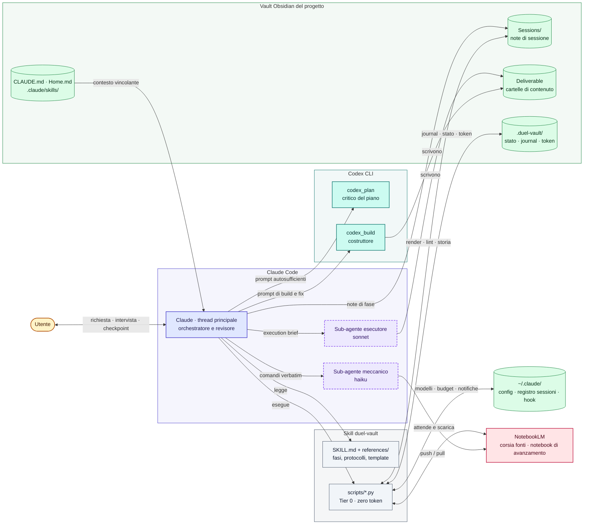
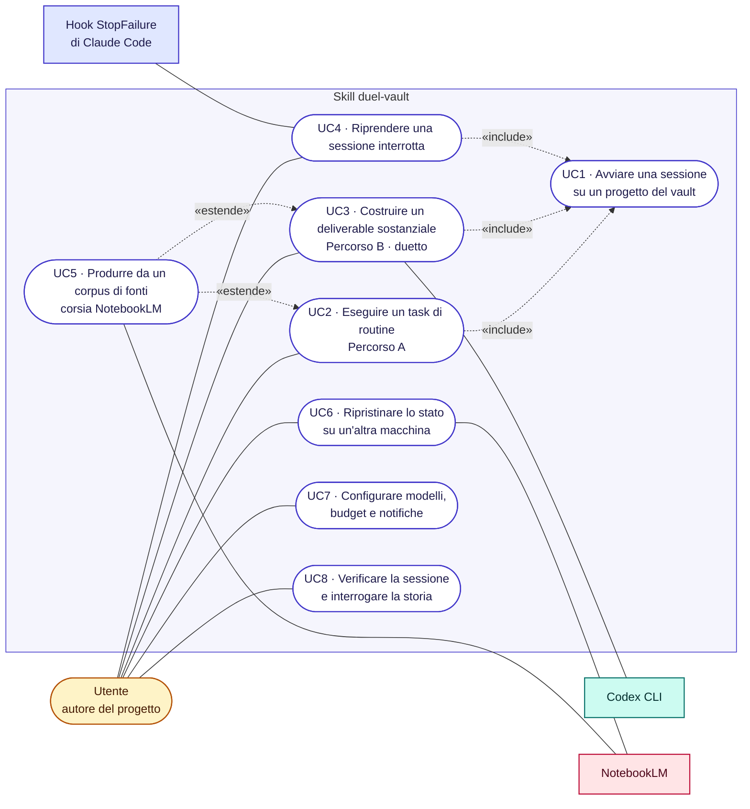
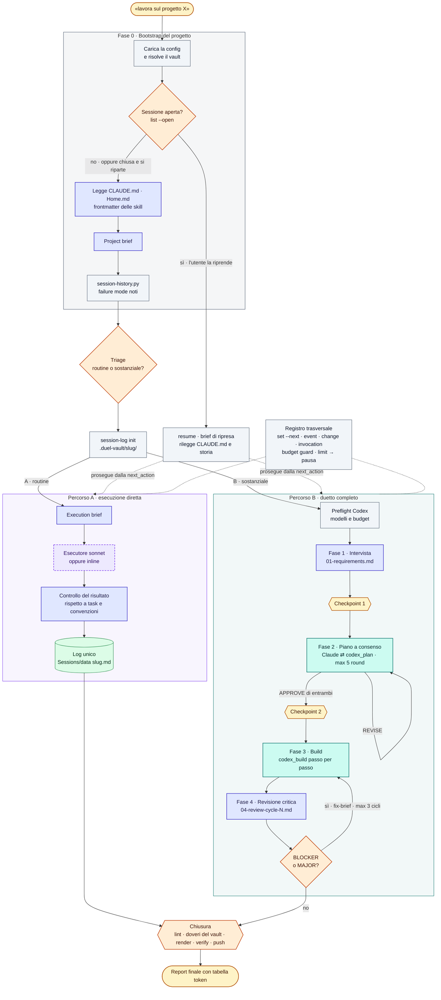
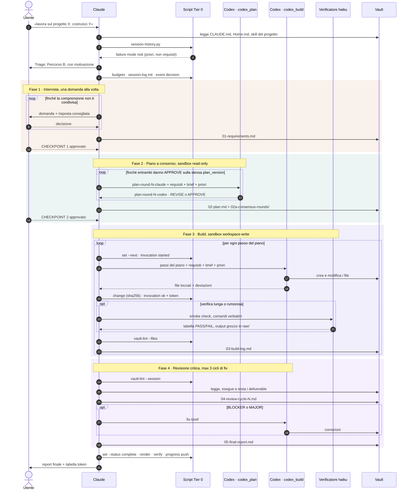
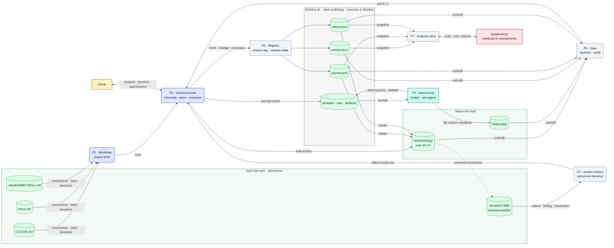
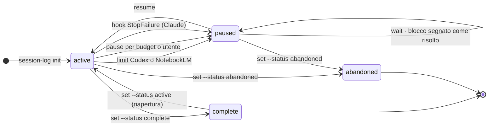
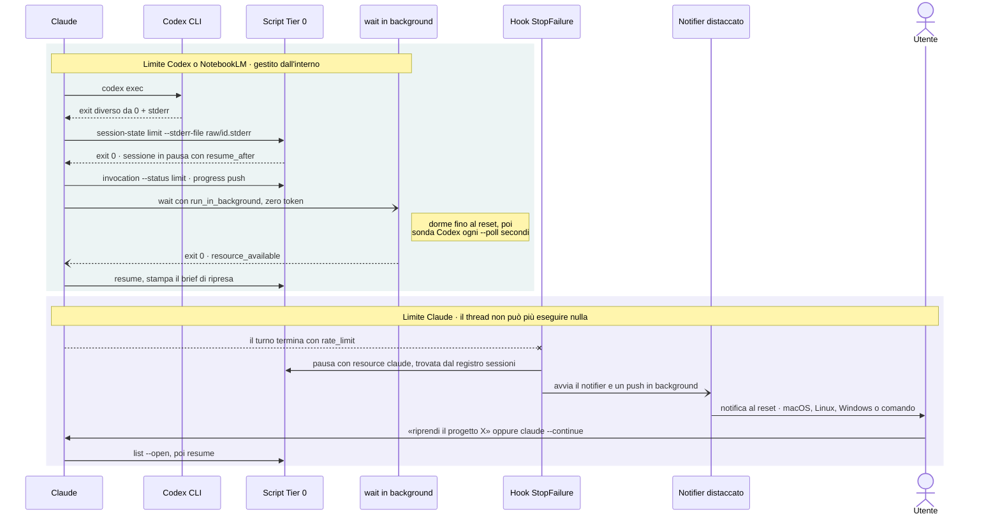
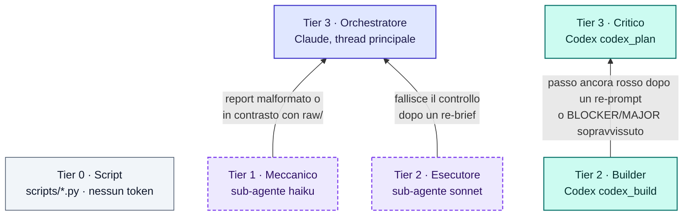

# duel-vault — come funziona

Architettura, casi d'uso e flussi dei dati della skill `duel-vault` per Claude Code.

| | |
|---|---|
| **Cosa descrive** | il comportamento della skill come definito da `SKILL.md`, `references/` e `scripts/` |
| **Allineato a** | stato del repository al 3 novembre 2026 |
| **Formato dei grafici** | Mermaid: si visualizza su GitHub e in Obsidian; in VS Code serve un'estensione Mermaid |

**Legenda**, uguale in tutti i diagrammi:

| Colore (bordo) | Forma | Elemento |
|---|---|---|
| ambra `#B45309` | ovale, esagono | utente, decisioni umane, checkpoint |
| indaco `#4338CA` | rettangolo | Claude, thread principale (orchestratore) |
| viola `#7C3AED` | rettangolo tratteggiato | sub-agenti Claude (`sonnet`, `haiku`) |
| verde acqua `#0F766E` | rettangolo | Codex CLI (`codex_plan`, `codex_build`) |
| ardesia `#475569` | rettangolo | script Python, Tier 0, nessun token di modello |
| verde `#15803D` | cilindro | archivi di dati: file del vault, working dir, configurazione |
| rosa `#BE123C` | rettangolo | servizi esterni (NotebookLM) |
| arancio `#C2410C` | rombo, esagono | gate e decisioni automatiche |

---

## 1. In sintesi

`duel-vault` collega **Claude** e **Codex** per lavorare su un progetto che vive dentro un vault Obsidian. Ogni scelta della skill discende da quattro principi:

1. **Il vault è la fonte di verità.** `CLAUDE.md` (convenzioni vincolanti), `Home.md` (stato) e le skill del progetto in `.claude/skills/` governano ogni decisione e viaggiano dentro ogni prompt.
2. **Il giudizio resta in alto, l'esecuzione scende di livello.** Triage, intervista, piano e revisione restano al thread principale di Claude. L'esecuzione va a sub-agenti o a Codex. Il lavoro deterministico va agli script e non consuma token.
3. **La quantità di processo dipende dal task.** Il **Percorso A** esegue direttamente i task di routine. Il **Percorso B** fa il duetto completo in quattro fasi. La **corsia NotebookLM** si aggiunge a uno dei due percorsi solo su richiesta esplicita.
4. **Ogni sessione è registrata e si può riprendere.** Journal append-only, `next_action` sempre aggiornata, pausa pulita sui limiti d'uso e ripresa automatica o notificata.

---

## 2. Vista d'insieme

Chi partecipa, dove vivono i dati e chi parla con chi.



**Come leggerlo.** Claude è l'unico nodo che parla con l'utente e l'unico che decide. Codex e i sub-agenti non hanno memoria: ricevono tutto il contesto nel prompt. Gli script sono il solo punto di scrittura per stato, journal e token, quindi il loro formato non può divergere.

---

## 3. Casi d'uso



| ID | Caso d'uso | Innesco tipico | Percorso | Output principali |
|---|---|---|---|---|
| **UC1** | Avviare una sessione su un progetto | «lavora sul progetto X», «apri una sessione su X», «duel vault» | Fase 0 + triage | vault risolto, project brief, failure mode noti, scelta del percorso |
| **UC2** | Eseguire un task di routine | «fai l'analisi mensile per X», un task coperto da una skill del progetto | **A** | deliverable + log unico `Sessions/<data> <slug>.md` |
| **UC3** | Costruire un deliverable sostanziale | «costruisci …», più passi, codice, requisiti da fissare | **B** | `Sessions/<slug>/00…07` + deliverable revisionati |
| **UC4** | Riprendere una sessione interrotta | «riprendi il progetto X», «Codex è di nuovo disponibile», `claude --continue` | ripresa | brief di ripresa con fase, passo e `next_action` |
| **UC5** | Produrre da un corpus di fonti | «usa NotebookLM», «fammi un podcast da queste fonti» | corsia opt-in su **A** o **B** | note importate, `.canvas`, `06-sources.md` |
| **UC6** | Ripristinare lo stato altrove | cartella `.duel-vault/` assente su una nuova macchina | `progress-sync pull --restore` | `session.json` delle sessioni aperte ricostruiti |
| **UC7** | Configurare | primo avvio, prima sessione B di un progetto | setup | `duel-vault.config.json`, hook `StopFailure` |
| **UC8** | Verificare e interrogare la storia | gate di chiusura, «cosa avevamo deciso sui grafici?» | trasversale | `verify`/`lint` con esito, `07-activity-log.md`, priori |

Un task partito sul Percorso A che cresce può essere **promosso** al Percorso B: Claude si ferma, spiega perché ed entra in Fase 1 con quanto già appreso.

---

## 4. Ciclo di vita di una sessione

Dalla richiesta al report finale, con i due percorsi, i checkpoint umani e i cicli di ritorno.



Note sul diagramma:

- **Ripresa.** Una sessione ripresa rilegge `CLAUDE.md`, che può essere cambiato, e rilancia `session-history.py`. Poi prosegue dalla `next_action` registrata, senza ripetere il triage.
- **Consenso.** Il piano è approvato quando Claude e Codex emettono entrambi `APPROVE` sulla stessa `plan_version`. Dopo 5 round senza accordo, Claude scrive `plan-disagreement.md` e decide l'utente.
- **Escalation.** Se la verifica di un passo fallisce ancora dopo un re-prompt correttivo, quel passo sale a `codex_plan`. Lo stesso vale per un BLOCKER o MAJOR che sopravvive a un ciclo di fix. Il passo successivo riparte dal livello economico.

---

## 5. Il Percorso B nel dettaglio

La sequenza completa del duetto, con i messaggi tra i partecipanti.



---

## 6. Flussi dei dati

### 6.1 Diagramma di flusso dei dati

Da dove entrano i dati, quali processi li trasformano, dove si depositano. La freccia tratteggiata in basso chiude il ciclo: le note di oggi diventano i priori della sessione successiva.



### 6.2 Dizionario dei dati

| Archivio | Posizione | Scritto da | Letto da | In Obsidian |
|---|---|---|---|---|
| Config | `~/.claude/duel-vault.config.json` | Claude (primo avvio), `session-state budgets` | tutti gli script | — |
| Registro sessioni | `~/.claude/duel-vault.sessions.json` | ogni scrittura di stato, sotto lock (id sessione Claude → vault/slug) | hook `on-stop-failure` | — |
| Hook | `~/.claude/settings.json` | `session-state install-hook` | Claude Code | — |
| Log notifiche | `~/.claude/duel-vault-notifications.log` | `notify` | utente | — |
| Contesto | `CLAUDE.md`, `Home.md`, `.claude/skills/` | utente | Fase 0 | sì |
| Stato | `.duel-vault/<slug>/session.json` | `session-log init`, `session-state` | `resume`, `verify`, `progress-sync` | no |
| Journal | `.duel-vault/<slug>/journal.jsonl` | `session-log`, `session-state`, `progress-sync` | `verify`, `render`, `resume` | no |
| Token | `.duel-vault/<slug>/tokens.json` | `session-log invocation`, `tokens add` | guard budget, `tokens summary` | no |
| Prompt e output grezzi | `.duel-vault/<slug>/prompts/`, `raw/`, `artifacts/` | Claude, Codex, verificatore, agente NotebookLM | Claude, `nblm-import` | no |
| Snapshot di avanzamento | `.duel-vault/progress/` | `progress-sync render/push`, un push alla volta sotto lock | `progress-sync`, `verify` (SL012) | no |
| Note di sessione | `Sessions/<slug>/00…07` (B) · `Sessions/<data> <slug>.md` (A) | Claude, `render`, `nblm-import manifest` | `vault-lint`, `session-history`, `verify` | sì |
| Deliverable | cartelle indicate da `CLAUDE.md` | Codex, esecutore, `nblm-import import` | Claude in revisione | sì |

### 6.3 Cosa esce dalla macchina

| Destinazione | Cosa riceve | Cosa non riceve mai |
|---|---|---|
| **Codex** (CLI, servizio OpenAI) | requisiti, piano, estratti del project brief, priori, passi da eseguire; in build accede in scrittura alla directory indicata con `-C` | la conversazione con Claude, se non come estratto nel prompt |
| **NotebookLM, notebook di avanzamento** (attivo per default) | righe del task, `next_action`, riepiloghi di decisioni e attività, percorsi dei file, percorso del vault | contenuti dei file, stderr grezzi conservati come prova di un limite |
| **NotebookLM, corsia fonti** (solo opt-in) | il corpus scelto dall'utente e i prompt di generazione | — |

Il notebook di avanzamento si disattiva con `"progress_notebook": {"enabled": false}`: lo snapshot resta solo locale.

---

## 7. Stato, registro e ripresa

### 7.1 Stati di una sessione

`session.json` attraversa quattro stati. Il passaggio a `paused` registra sempre la causa (`blocked_on`): risorsa, tipo di limite, orario di reset, prova. Quando `wait` vede tornare la risorsa, il blocco resta registrato e viene segnato come risolto (`cleared_at`). La sessione rimane `paused` finché `resume` non la riattiva e sposta il blocco nello storico.



La regola che rende possibile la ripresa: **`next_action` si scrive prima di ogni passo, non dopo.** Un limite di Claude interrompe il turno senza preavviso. Quello che `next_action` dice in quel momento è ciò che farà la sessione successiva.

### 7.2 Due tipi di interruzione



| Causa della pausa | Chi la rileva | Come si sblocca | `resume` |
|---|---|---|---|
| Limite Codex / NotebookLM | `session-state limit` sullo stderr | `wait` in background: attesa fino al reset, poi sonde | rifiuta (exit 5) finché il reset è futuro o ignoto, salvo `--force` |
| Limite Claude | hook `StopFailure` | notifier distaccato: notifica al reset o quando una sonda `claude -p` risponde | riprende subito: se Claude esegue `resume`, il limite è finito |
| Budget superato (exit 4) | `invocation` / `tokens add` | l'utente alza il budget con `set --budget` | rifiuta finché la sessione resta oltre il budget, salvo `--force` |
| Scelta dell'utente | `session-state pause` | decisione dell'utente | riprende |

---

## 8. Corsia NotebookLM (opt-in)

La corsia resta chiusa se l'utente non la chiede esplicitamente. Il thread principale non resta mai bloccato in attesa, e nulla entra nel vault senza frontmatter e provenienza.

```mermaid
flowchart LR
    A(["Richiesta esplicita<br/>«usa NotebookLM»"]):::user
    PF{"auth check --test<br/>token_fetch true?"}:::gate
    STOP["Corsia chiusa<br/>oppure sessione in pausa"]:::gate
    NBC["notebooklm create<br/>id esplicito in session.json"]:::claude
    SRC["Fonti<br/>source add · research"]:::ext
    GEN["generate report, audio, …<br/>task_id registrato come pending"]:::claude
    AG["Agente haiku in background<br/>artifact wait + download"]:::agent
    ART[(".duel-vault/slug/artifacts/")]:::store
    IMP["nblm-import.py import<br/>frontmatter · provenienza · .canvas"]:::script
    NOUT[("Note nel vault<br/>source: notebooklm")]:::store
    MAN["nblm-import.py manifest"]:::script
    S06[("06-sources.md<br/>fonti · artefatti · prompt")]:::store
    LINT{"vault-lint<br/>VD023"}:::gate

    A --> PF
    PF -->|"no"| STOP
    PF -->|"sì"| NBC --> SRC --> GEN
    GEN -.->|"run_in_background"| AG
    AG --> ART --> IMP --> NOUT
    SRC --> MAN --> S06
    NOUT & S06 --> LINT

    classDef user fill:#FEF3C7,stroke:#B45309,color:#451A03,stroke-width:1.5px
    classDef claude fill:#E0E7FF,stroke:#4338CA,color:#1E1B4B,stroke-width:1.5px
    classDef agent fill:#EDE9FE,stroke:#7C3AED,color:#2E1065,stroke-width:1.5px,stroke-dasharray:5 3
    classDef script fill:#F1F5F9,stroke:#475569,color:#0F172A,stroke-width:1px
    classDef store fill:#DCFCE7,stroke:#15803D,color:#052E16,stroke-width:1px
    classDef ext fill:#FFE4E6,stroke:#BE123C,color:#4C0519,stroke-width:1.5px
    classDef gate fill:#FFEDD5,stroke:#C2410C,color:#431407,stroke-width:1.5px
```



Tre regole tengono la corsia sotto controllo:

- **Il thread principale non si blocca.** La generazione la avvia il thread principale. L'attesa e il download li fa un agente sul livello meccanico, che non genera, non ripianifica e non scrive nel vault.
- **Nessun file grezzo entra nel vault.** Tutto passa da `nblm-import.py`, che aggiunge frontmatter, campi obbligatori del vault, callout di provenienza e wikilink alla sessione.
- **Ogni artefatto è attribuibile.** Gli artefatti non sono riproducibili, quindi si registrano gli input: `06-sources.md` elenca fonti, artefatti e prompt. Se la corsia è dichiarata e il file manca, `vault-lint` segnala un errore.

In Fase 3 c'è un'eccezione documentata: Codex non ha autenticazione Google nella sandbox. Per questo Claude esegue di persona i passi NotebookLM del piano e passa a Codex solo i file materializzati.

---

## 9. Livelli di modello ed escalation



| Livello | Chi | Default | Fa | Contabilità dei token |
|---|---|---|---|---|
| 0 · Script | `scripts/*.py` | — | lint, storia, import NotebookLM, journal, stato | nessun token |
| 1 · Meccanico | sub-agente Claude | `haiku` | esegue comandi verbatim e riporta PASS/FAIL; attende e scarica da NotebookLM | `claude_delegated`, misurati o `unavailable` |
| 2 · Esecutore | sub-agente Claude | `sonnet` | esegue il Percorso A da un brief autosufficiente | `claude_delegated` |
| 2 · Builder | Codex | scelto dall'utente, economico | passi di build e cicli di fix | `codex`, misurati per invocazione |
| 3 · Critico | Codex | scelto dall'utente, il più forte | critica del piano, destinazione dell'escalation | `codex` |
| 3 · Orchestratore | Claude | modello della sessione | triage, intervista, piano, arbitrato, revisione, log | `claude_main`, stimati `ceil(caratteri/4)` |

L'escalation riguarda **un solo passo** e resta sempre tracciata con `> [!escalation]`. Il passo successivo riparte dal livello economico. Se `session-history.py` mostra che uno stesso tipo di passo sale spesso di livello, al triage Claude propone di partire più in alto. La proposta va all'utente e non diventa mai un cambio silenzioso.

---

## 10. Gate deterministici

Due script verificano ciò che si può decidere col codice, senza costo e senza rischio di allucinazioni. La revisione di Claude parte dopo, e si concentra su ciò che richiede giudizio.

| Momento | `vault-lint.py` (note) | `session-log.py verify` (registro) |
|---|---|---|
| Dopo ogni invocazione di build | `--files` sulle note toccate; Codex lo esegue anche come autoverifica | — |
| Ogni checkpoint e ogni pausa | — | sì, insieme a `progress-sync push` |
| Inizio Fase 4 | `--session`: ogni ERROR è almeno un MAJOR | — |
| Chiusura Percorso B | `--session` deve uscire con 0 | dopo `complete` e `render`, deve uscire con 0 |
| Chiusura Percorso A | `--files` sul log unico | come sopra, con il blocco `Attività` incollato nel log |

**Cosa controllano.** `vault-lint` controlla schema del frontmatter, tag, wikilink, coerenza tra nomi dei file e frontmatter, struttura della sessione, copertura dei requisiti `R1…Rn` tra requisiti, piano e report, e provenienza NotebookLM. `verify` controlla la continuità del journal, gli invocation rimasti senza esito, la coerenza tra registro token e invocazioni, gli hash dei file registrati (rileva modifiche non registrate), i callout `> [!decision]` corrispondenti alle decisioni e i push in coda.

### Codici di uscita

| Script | 0 | 1 | 2 | 3 | 4 | 5 | 6 |
|---|---|---|---|---|---|---|---|
| `session-log.py` | ok | errori di verify | uso errato | budget ≥ 80% | budget superato | — | — |
| `session-state.py` | ok / limite riconosciuto | non è un limite / sonda in errore | uso errato | budget ≥ 80% | budget superato | ancora bloccata | `wait` rinuncia |
| `progress-sync.py` | inviato / invariato / disattivato | pull fallito | uso errato | push in coda | — | — | — |
| `vault-lint.py` | pulito | errori | uso errato o percorso illeggibile | — | — | — | — |

---

## 11. Mappa dei file prodotti da una sessione B

```text
<vault>/
├── CLAUDE.md, Home.md, .claude/skills/        ← input, letti in Fase 0
├── Sessions/<slug>/                           ← visibile in Obsidian
│   ├── 00 - <slug> MOC.md                     indice, stato, decisioni chiave
│   ├── 01-requirements.md                     R1…Rn  · Checkpoint 1
│   ├── 02-plan.md                             piano approvato · Checkpoint 2
│   ├── 02a-consensus-rounds/                  plan-round-N-{claude,codex}.md
│   ├── 03-build-log.md                        un'invocazione per voce, scritta durante il lavoro
│   ├── 04-review-cycle-N.md                   finding BLOCKER / MAJOR / MINOR
│   ├── 05-final-report.md                     esito per requisito, residui, token
│   ├── 06-sources.md                          solo con la corsia NotebookLM
│   └── 07-activity-log.md                     generato dal journal, non si modifica a mano
└── .duel-vault/                               ← nascosta a Obsidian
    ├── <slug>/
    │   ├── session.json                       stato, next_action, pending, blocked_on
    │   ├── journal.jsonl                      eventi append-only, seq 1…n
    │   ├── tokens.json                        registro dei token per fase, risorsa e modello
    │   ├── prompts/  raw/  artifacts/         prompt, output grezzi, download NotebookLM
    │   └── .lock                              lock di sessione per scritture concorrenti
    └── progress/                              snapshot per il notebook di avanzamento
```

Per i dettagli operativi: [`SKILL.md`](SKILL.md) e i file in [`references/`](references/).
