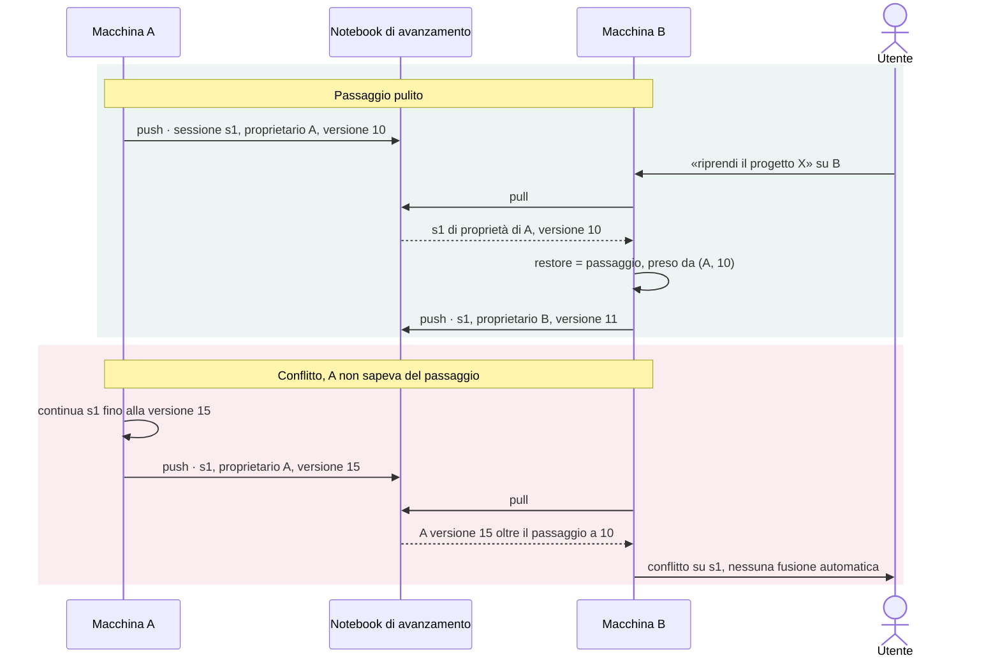

# Proposta — snapshot di avanzamento tra più macchine

| | |
|---|---|
| **Stato** | proposta, in attesa delle decisioni del §9 |
| **Data** | 3 novembre 2026 |
| **Origine** | [`REVIEW.md`](REVIEW.md), miglioramento 1: la parte che il lock locale non risolve |
| **Riguarda** | `scripts/progress-sync.py`, `scripts/session-state.py`, `scripts/session_common.py` |

## 1. Contesto

Ogni progetto ha un notebook NotebookLM di avanzamento: uno specchio dello stato delle sessioni, che serve a riprendere il lavoro su un'altra macchina (`progress-sync pull --restore`) e a interrogare la storia del progetto. Il vault resta la fonte di verità.

Dal 3 novembre i push della **stessa macchina** sono serializzati da un lock per vault (`.duel-vault/progress/.push.lock`). Tra **macchine diverse** non c'è alcun coordinamento: questa nota propone come gestirle.

## 2. Problemi attuali

| # | Problema | Dove | Effetto |
|---|---|---|---|
| P1 | Tutte le macchine pubblicano una fonte con lo stesso titolo, `duel-vault-state-<progetto>.md`. Ognuna cancella solo la propria versione precedente, il cui id è salvato in `notebook.json` locale | `state_file()`, `push_locked()` | si accumula una fonte per macchina, tutte con lo stesso nome. `pull` usa l'id in cache o, in mancanza, l'ultima dell'elenco, che non è necessariamente la più recente (`cmd_pull()`) |
| P2 | Lo snapshot contiene solo le sessioni aperte sulla macchina che lo pubblica | `render_state()` | una chiusura fatta su A è invisibile per B, che continua a pubblicare la sessione come aperta |
| P3 | `restore` salta le sessioni già presenti in locale | `restore()` | una copia locale più vecchia non viene segnalata; due macchine possono lavorare la stessa sessione senza accorgersene |
| P4 | I riepiloghi delle sessioni chiuse sono deduplicati con un elenco locale | `meta["session_sources"]` | due macchine possono pubblicare lo stesso riepilogo |
| P5 | Il notebook si cerca per titolo e, se manca, si crea | `ensure_notebook()` | due primi push simultanei da macchine diverse creano due notebook con lo stesso titolo |

## 3. Vincoli

- **Nessuna operazione atomica.** NotebookLM non offre compare-and-swap né un ordinamento affidabile dell'elenco delle fonti: un lock distribuito non si può costruire in modo sicuro.
- **Orologi non sincronizzati.** L'ordine tra macchine non può dipendere dall'ora di sistema.
- **Il vault è la fonte di verità.** Il notebook è uno specchio: non sovrascrive mai in silenzio uno stato locale.
- **Mai bloccare la sessione.** Se NotebookLM non risponde, si procede con un avviso.
- **Nessun contenuto di file lascia la macchina.** Valgono le regole attuali di `publishable()`.

## 4. Proposta

In una frase: **una fonte per macchina, sessioni con proprietario e versione, fusione in lettura.**

### 4.1 Identità della macchina

Un file `~/.claude/duel-vault.machine.json`, creato al primo uso: `{"id": "<uuid>", "label": "<hostname>"}`. Sta in un file separato, non in `duel-vault.config.json`, perché la configurazione può essere sincronizzata tra macchine (dotfile) e l'id deve restare diverso su ciascuna.

### 4.2 Una fonte di stato per macchina — risolve P1

Il titolo diventa `duel-vault-state-<progetto>@<label>-<id8>.md`, dove `<id8>` sono i primi otto caratteri dell'id. Ogni macchina sostituisce **solo la propria** fonte, cercandola per titolo nell'elenco, non per id in cache: così una `notebook.json` persa o copiata non lascia fonti orfane. Nessuna macchina sovrascrive la fonte di un'altra.

### 4.3 Proprietario e versione per sessione — risolve P2 e P3

`session.json` riceve un blocco `sync`:

```json
"sync": {
  "owner": "<id della macchina che lavora la sessione>",
  "version": 42,
  "took_over_from": {"machine": "<id>", "version": 10}
}
```

- Una sessione nuova nasce con `owner` = questa macchina e `version` = 1.
- `version` aumenta di uno a ogni salvataggio dello stato, solo sulla macchina proprietaria. Il contatore sopravvive al ripristino, a differenza della numerazione del journal, che su una nuova macchina riparte da 1.
- La proprietà passa solo con un **passaggio esplicito**: chi prende la sessione registra in `took_over_from` da quale macchina e da quale versione è partito, poi continua il contatore.
- Ogni macchina pubblica solo le sessioni di cui è proprietaria, più le sessioni chiuse di recente come **segnali di chiusura** (*tombstone*): `{session, status, owner, version, closed_at}`. Così una chiusura fatta su A prevale sulla copia ancora aperta altrove.

### 4.4 Fusione in lettura

`pull` legge tutte le fonti `duel-vault-state-<progetto>@*` e, per ogni sessione, confronta i record delle diverse macchine:

1. Il record di B **supera** quello di A se B ha preso la sessione da A (`took_over_from.machine` = A) a una versione maggiore o uguale a quella pubblicata da A.
2. C'è un **conflitto** se A ha continuato dopo il passaggio, cioè se la versione pubblicata da A supera `took_over_from.version` di B, oppure se due macchine pubblicano la stessa sessione senza alcun passaggio tra loro.
3. Un conflitto non si risolve mai in automatico: `pull` mostra i due record (fase, `next_action`, versione, macchina) e decide l'utente.
4. L'ora di salvataggio compare solo come informazione, mai come criterio di scelta.

| Caso | Record di A | Record di B | Esito |
|---|---|---|---|
| Passaggio pulito | proprietario A, versione 10 | proprietario B, versione 12, preso da (A, 10) | vince B |
| A ha continuato senza saperlo | proprietario A, versione 15 | proprietario B, versione 12, preso da (A, 10) | **conflitto** |
| Chiusa su B | proprietario A, versione 10 | chiusura di B, versione 13, presa da (A, 10) | chiusa |
| Stesso slug creato su due macchine | proprietario A, versione 4 | proprietario B, versione 7, nessun passaggio | **conflitto** |



### 4.5 Controllo alla ripresa

In Fase 0 e in `resume`, la skill esegue `progress-sync pull --check`: legge e fonde senza scrivere nulla, con un timeout breve, e se NotebookLM non risponde la ripresa prosegue con un avviso.

- Se la sessione risulta più avanti su un'altra macchina, `resume` rifiuta (exit 5) e spiega dove e a che punto si trova.
- `resume --take-over` prende la sessione in modo esplicito e registra il passaggio.
- Una copia locale superata non viene mai cancellata: prima del ripristino viene archiviata in `.duel-vault/.superseded/<slug>-<data>/`, una cartella che `list_sessions()` già ignora perché inizia con un punto.

Il controllo è **consultivo**, non un lock: due riprese della stessa sessione a pochi secondi di distanza procedono entrambe, e il conflitto emerge al `pull` successivo.

### 4.6 Riepiloghi, notebook duplicati, pulizia — risolve P4 e P5

- **Riepiloghi:** prima di aggiungerne uno, `push` controlla i titoli presenti nell'elenco del notebook, non più un elenco locale.
- **Notebook duplicati:** se più notebook hanno lo stesso titolo, tutte le macchine scelgono lo stesso con un criterio deterministico, per esempio l'id più basso, e mostrano un avviso.
- **Pulizia:** una macchina può eliminare la fonte di un'altra solo se tutte le sessioni che contiene sono chiuse o superate e se la fonte è più vecchia del periodo di conservazione (proposto: 30 giorni).

## 5. Cosa non garantisce

- **Mutua esclusione.** Senza operazioni atomiche non esiste: due riprese quasi simultanee vengono rilevate solo a posteriori, come conflitto, senza perdita di dati.
- **La cronologia del journal** continua a non viaggiare tra macchine, come oggi: il ripristino ricrea lo stato, non gli eventi passati.
- **Il periodo di conservazione** si misura con l'ora di sistema, quindi è approssimativo. È l'unico punto in cui conta l'orologio, e solo per la pulizia.

## 6. Compatibilità

- Il blocco leggibile dalla macchina passa allo schema 2. `pull` continua a leggere lo schema 1.
- Una fonte con il titolo attuale si legge come pubblicata da una macchina «legacy». Le sessioni senza blocco `sync` valgono come versione 0 senza proprietario, quindi qualunque record con versione le supera.
- Al primo push dopo l'aggiornamento, ogni macchina pubblica la propria fonte con il nuovo titolo ed elimina la vecchia solo se l'id corrisponde a quello nella sua `notebook.json`.

## 7. Alternative scartate

| Alternativa | Perché no |
|---|---|
| Vince l'ultimo che scrive, in base all'orario | dipende da orologi non sincronizzati e cancella in silenzio le sessioni delle altre macchine |
| Un lock simulato con una fonte nel notebook | senza operazioni atomiche due macchine possono comunque prenderlo insieme; costa più del controllo consultivo e garantisce lo stesso |
| Una sola fonte condivisa, fusa e riscritta da ogni push | due push quasi simultanei da macchine diverse si sovrascrivono a vicenda: è il problema attuale, spostato |

## 8. Piano di implementazione

| Fase | Contenuto | Dimensione |
|---|---|---|
| 1 | identità della macchina, una fonte per macchina, `sync.version`, fusione in `pull`, deduplica dei riepiloghi tramite l'elenco, compatibilità con lo schema 1 | media |
| 2 | proprietario e passaggio esplicito, chiusure pubblicate, rilevamento dei conflitti, `pull --check` in `resume` con `--take-over`, archiviazione delle copie superate | media |
| 3 | pulizia delle fonti delle macchine inattive, scelta deterministica tra notebook duplicati | piccola |

**Test.** L'impianto attuale basta: due HOME distinte, cioè due identità di macchina, e due copie del vault che condividono lo stesso NotebookLM simulato. Un caso per ogni riga della tabella del §4.4, più un caso con NotebookLM non raggiungibile durante `resume`.

## 9. Decisioni aperte

| # | Decisione | Opzioni | Raccomandazione |
|---|---|---|---|
| D1 | Come si sincronizzano i vault tra le macchine? | git · iCloud · Obsidian Sync · nessuna sincronizzazione | da indicare. Se `.duel-vault/` viaggia già con il vault, il problema si riduce molto e la fase 2 cambia forma |
| D2 | Sessione più avanti su un'altra macchina | `resume` rifiuta finché non si usa `--take-over` · solo avviso | rifiutare |
| D3 | `resume` consulta NotebookLM? | sì, con timeout breve e senza bloccare · no, solo `pull` manuale | sì |
| D4 | Conservazione delle fonti di macchine inattive | 30 giorni · altro valore · mai eliminare | 30 giorni |

Collegamenti: [`REVIEW.md`](REVIEW.md) (miglioramento 1) · [`ARCHITETTURA.md`](ARCHITETTURA.md) (§6.3 e §7) · [`references/session-recovery.md`](references/session-recovery.md) (progress notebook).
